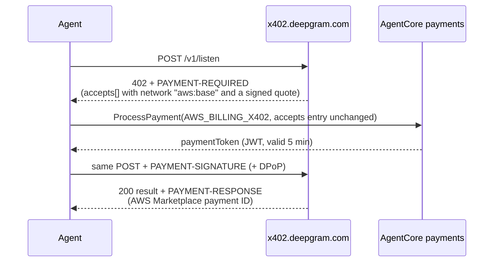

# Deepgram on AWS Marketplace: pay-per-request with AgentCore payments

Call Deepgram speech-to-text and text-to-speech from an AI agent and pay per request on your AWS bill. You don't need a Deepgram account or API key. Deepgram's endpoint `https://x402.deepgram.com` is sold on AWS Marketplace and uses [x402](https://www.x402.org/). Your agent pays each quote with [Amazon Bedrock AgentCore payments](https://docs.aws.amazon.com/bedrock-agentcore/latest/devguide/payments-how-it-works.html) (AWS Billing).

| Example | What it shows |
|---|---|
| [`python/deepgram_x402.py`](python/deepgram_x402.py) | The whole flow in ~150 lines of boto3: 402 → `ProcessPayment` → retry, with optional DPoP |
| [`python/stt_url.py`](python/stt_url.py), [`stt_file.py`](python/stt_file.py), [`stt_s3_presigned.py`](python/stt_s3_presigned.py) | Speech-to-text from a URL, a local file, or a large file in your S3 bucket |
| [`python/tts.py`](python/tts.py) | Text-to-speech with Flux TTS or Aura-2 |
| [`python/strands_agent.py`](python/strands_agent.py) | A [Strands](https://strandsagents.com) agent with paid Deepgram tools |
| [`python/langgraph_agent.py`](python/langgraph_agent.py) | A LangGraph (`langchain` `create_agent`) agent with the same tools |
| [`typescript/`](typescript/) | The same flow with AWS SDK for JavaScript v3 |
| [`python/setup_account.py`](python/setup_account.py) | One-time account setup: service-linked role, Payment Manager, AWS Billing connector |

## Endpoints

All endpoints are `POST`, batch (no streaming), and priced per request at [Deepgram's pay-as-you-go rates](https://deepgram.com/pricing); each `402` quote states the exact USD price of that request. Query parameters are the regular [Deepgram API](https://developers.deepgram.com/reference/deepgram-api-overview) ones.

| Endpoint | Product | Billed by |
|---|---|---|
| `/v1/listen` | Speech-to-text, `nova-3` | Audio minute (Nova-3 pre-recorded rate, multilingual with `language=multi`), plus add-ons `keyterm`, `redact`, `detect_entities` |
| `/v2/speak` | Flux TTS, `model=flux-{voice}-{language}` (required), e.g. `flux-haley-en` | 1,000 input characters (Flux TTS rate) |
| `/v1/speak` | Aura-2 TTS, e.g. `model=aura-2-thalia-en` | 1,000 input characters (Aura-2 rate) |

- **`/v1/listen` body:** `{"url": "https://..."}` with `Content-Type: application/json` (any length; the URL must be fetchable, e.g. an S3 presigned URL), or raw audio up to ~4.5 MB with `Content-Type: audio/wav` (or `audio/mpeg`, `audio/flac`, `audio/ogg`).
- **`/v1/speak`, `/v2/speak` body:** `{"text": "..."}`. Returns audio (MP3 by default; set `encoding`, `sample_rate`, `container`, and for Flux `bit_rate`, `speed`).
- **`callback` isn't supported.** Results come back synchronously.

## How paying works



`PAYMENT-SIGNATURE` is base64 JSON `{"x402Version": 2, "resource": <from the 402>, "accepted": <the aws:base entry>, "payload": {"paymentToken": <token>}}`. The charge appears on your AWS bill under AWS Marketplace.

- A paid quote is valid for 5 minutes.
- A failed request (e.g. a `400` for an unsupported parameter) doesn't use up the payment. Retry with corrected parameters, as long as the new request costs no more than what you paid.
- The examples bind the payment token to an ephemeral key with [DPoP](https://datatracker.ietf.org/doc/html/rfc9449), so a leaked token can't be replayed. Set `USE_DPOP=0` to turn this off.

The AgentCore payments plugins for Strands and LangGraph (`bedrock-agentcore[strands-agents]`, `bedrock-agentcore[langgraph]`) only pay stablecoin (`CRYPTO_X402`) quotes today. The agent examples here therefore wrap Deepgram as tools that call `ProcessPayment` with `AWS_BILLING_X402` directly.

## Setup

**Prerequisites:** an AWS account, AWS credentials, and Python 3.10+ with [uv](https://docs.astral.sh/uv/) (setup and Python examples) or Node.js 20+ (TypeScript examples). Setup uses boto3 1.44.7+, so it doesn't depend on your AWS CLI version. AgentCore payments processes AWS Billing payments in `us-east-1`.

1. **Account setup (once, as an administrator; safe to re-run):**

   ```bash
   cd python
   uv run setup_account.py DeepgramPayments us-east-1
   export PAYMENT_MANAGER_ARN=arn:aws:bedrock-agentcore:us-east-1:...   # printed by the script
   ```

   This creates the AWS Marketplace service-linked role `AWSServiceRoleForMarketplaceAgenticCommerce`, the Payment Manager service role `AgentCorePaymentsResourceRetrievalRole` with its base permissions, a Payment Manager, and an AWS Billing connector. AWS Marketplace creates and accepts the purchase agreement for the listing automatically on your first payment. The administrator needs the permissions in [Administrator permissions](https://docs.aws.amazon.com/bedrock-agentcore/latest/devguide/payments-iam-roles.html#payments-iam-admin), including `iam:CreateServiceLinkedRole` and `iam:GetRole` for the service-linked role.

2. **Create a payment session with a spend limit.** Run this as the identity that manages budgets, not as the agent:

   ```bash
   cd python
   uv run create_session.py 1.00 60          # $1.00 limit, 60 minutes (15-480)
   export PAYMENT_SESSION_ID=payment-session-...
   ```

3. **Run an example** as an identity with `bedrock-agentcore:ProcessPayment` and `bedrock-agentcore:GetPaymentSession` on the Payment Manager:

   ```bash
   cd python
   uv run stt_url.py https://dpgr.am/spacewalk.wav
   uv run tts.py "Your appointment is confirmed for 3pm tomorrow." flux-haley-en
   uv run --extra strands strands_agent.py "Transcribe https://dpgr.am/spacewalk.wav and summarize it."
   uv run --extra langgraph langgraph_agent.py "Say 'your order has shipped' in a friendly voice."
   ```

   ```bash
   cd typescript && npm install
   npm run listen -- https://dpgr.am/spacewalk.wav
   npm run speak -- "Hello from Deepgram." aura-2-thalia-en
   ```

   The agent examples call a Claude model on Amazon Bedrock. Set `BEDROCK_MODEL_ID` to a model your account can use.

AWS recommends keeping budget management and payment execution in separate roles, so an agent can't raise its own limit. See [IAM roles for AgentCore payments](https://docs.aws.amazon.com/bedrock-agentcore/latest/devguide/payments-iam-roles.html).

| Variable | Used by | Meaning |
|---|---|---|
| `PAYMENT_MANAGER_ARN` | all | Payment Manager with an AWS Billing connector |
| `PAYMENT_SESSION_ID` | all except `create_session.py` | Session whose spend limit caps what the examples can spend |
| `PAYMENT_USER_ID` | optional | End-user ID the session belongs to (default `deepgram-example-user`). Required by the API; `ProcessPayment` must use the session's user |
| `USE_DPOP` | optional | `0` to send the payment token without DPoP |
| `BEDROCK_MODEL_ID` | agent examples | Bedrock model for Strands/LangGraph |

## Troubleshooting

| Symptom | Cause |
|---|---|
| `CreatePaymentManager` "Access denied while creating workload identity" | The service role lacks the base permissions. `setup_account.py` adds them. |
| `userId is required` | Set `PAYMENT_USER_ID` (or use the default) consistently for `create_session.py` and the examples. |
| `ProcessPayment` `ValidationException` about the quote | The quote expired (5 minutes) or was modified. Request again and pass the new `accepts` entry unchanged. |
| `ProcessPayment` budget error | The session spend limit is used up or the session expired. Create a new session. |
| `payment refused: dpop_required` / `dpop_invalid` | The token is DPoP-bound but the proof is missing, or it doesn't match the method/URL/token. |
| `payment refused: payment already used` | Each payment pays for one successful request. |
| `400` from Deepgram | Unsupported parameter (e.g. `callback`). You weren't charged; fix and retry. |

AWS's list of AWS Billing errors is in [Troubleshooting](https://docs.aws.amazon.com/bedrock-agentcore/latest/devguide/payments-troubleshooting.html#payments-troubleshooting-aws-billing).

## Links

- [AgentCore payments: how it works](https://docs.aws.amazon.com/bedrock-agentcore/latest/devguide/payments-how-it-works.html)
- [Pay with AWS Billing (`ProcessPayment`)](https://docs.aws.amazon.com/bedrock-agentcore/latest/devguide/payments-process-payment.html#payments-process-payment-aws-billing)
- [Create a Payment Manager and connector](https://docs.aws.amazon.com/bedrock-agentcore/latest/devguide/payments-create-manager.html)
- [Service-linked role for AgentCore payments](https://docs.aws.amazon.com/marketplace/latest/buyerguide/buyer-service-linked-role-agentic-commerce.html)
- [Deepgram API reference](https://developers.deepgram.com/reference/deepgram-api-overview)

## License

MIT
